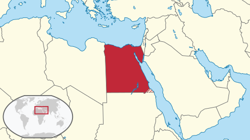
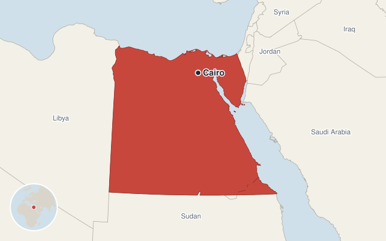
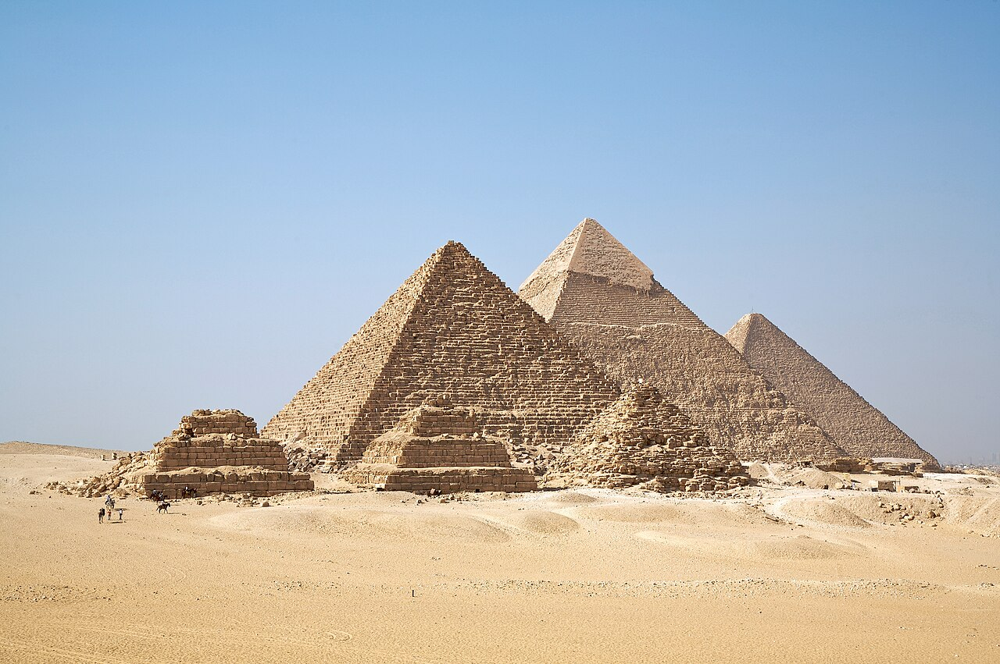

---
id    = "45901bce-b741-5376-ac0f-1730ab00d4e1"
model = "Basic"
tags  = ["africa", "mediterranean", "middle_east", "sovereign_state", "map"]
---

## Front

What is highlighted on this map?

## Back

<b>Egypt</b>

## Extra

<i>Photo: Ricardo Liberato, CC BY-SA 2.0, via Wikimedia Commons</i>

Borders Libya, Sudan, Israel and the Gaza Strip About 114 million people (2026), the most of any Arab country

Mostly desert: about 99% of Egyptians live along the narrow Nile Valley and Delta, on about 5.5% of the land. The Sinai Peninsula puts its northeast corner in Asia.

<a href="https://en.wikipedia.org/wiki/Egypt">Egypt on Wikipedia</a>
