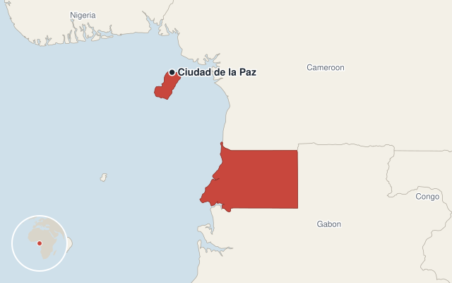
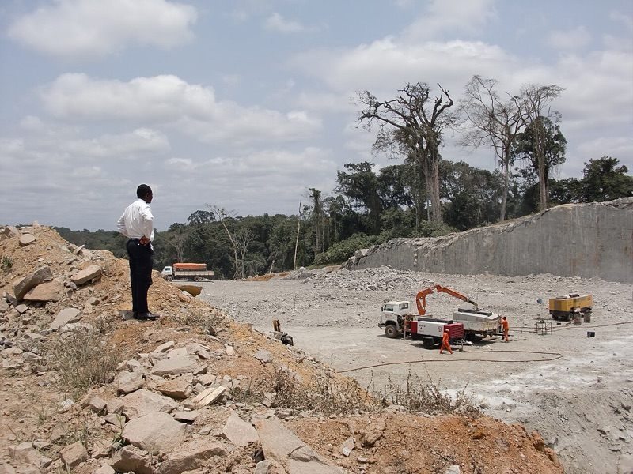

---
id    = "4dc81d80-a588-53a7-ac43-a4c4682d6c04"
model = "Basic"
tags  = ["africa", "sovereign_state", "capital"]
---

## Front

What is the capital of <b>Equatorial Guinea</b>?

## Back

<b>Ciudad de la Paz</b>

## Extra

<i>Photo: eigenes Bild,--Mehlauge (talk) 09:36, 13 December 2010 (UTC), CC BY-SA 3.0, via Wikimedia Commons</i>

About 2,000 people (2022), planned for about 200,000 Inland, at 454 m

The name means "City of Peace". The site, once called Oyala, was chosen for its inland location after a 2004 coup attempt raised fears about maritime access to the capital.

Official capital was moved from Malabo to Ciudad de la Paz in 2026.

<a href="https://en.wikipedia.org/wiki/Ciudad_de_la_Paz">Ciudad de la Paz on Wikipedia</a> <a href="https://en.wikipedia.org/wiki/Equatorial_Guinea">Equatorial Guinea on Wikipedia</a>
