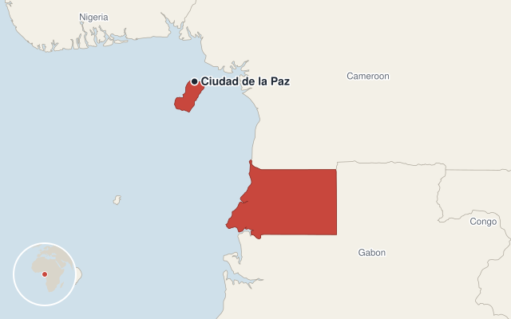

---
id    = "b8f1a9b3-bb7e-50f8-8af0-6fa5918a9430"
model = "Basic"
tags  = ["africa", "sovereign_state", "country"]
---

## Front

<b>Ciudad de la Paz</b> is the capital of which country or territory?

## Back

<b>Equatorial Guinea</b>

## Extra

Official capital was moved from Malabo to Ciudad de la Paz in 2026.

<a href="https://en.wikipedia.org/wiki/Equatorial_Guinea">Equatorial Guinea on Wikipedia</a> <a href="https://en.wikipedia.org/wiki/Ciudad_de_la_Paz">Ciudad de la Paz on Wikipedia</a>
