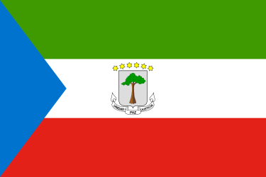
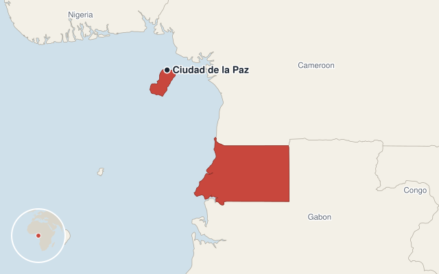

---
id    = "c219cfb1-afe0-558b-ae6f-b1b5ce948478"
model = "Basic"
tags  = ["africa", "sovereign_state", "flag"]
---

## Front

Whose flag is this?

## Back

<b>Equatorial Guinea</b>

## Extra

Adopted on 21 August 1979

A silk-cotton tree on the coat of arms recalls the local legend that indigenous and Spanish representatives signed their first treaty beneath one. Six stars stand for the mainland and five islands.

<a href="https://en.wikipedia.org/wiki/Flag_of_Equatorial_Guinea">Flag of Equatorial Guinea on Wikipedia</a> <a href="https://en.wikipedia.org/wiki/Equatorial_Guinea">Equatorial Guinea on Wikipedia</a>
