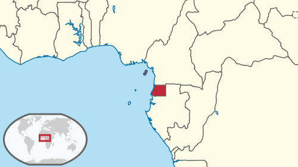
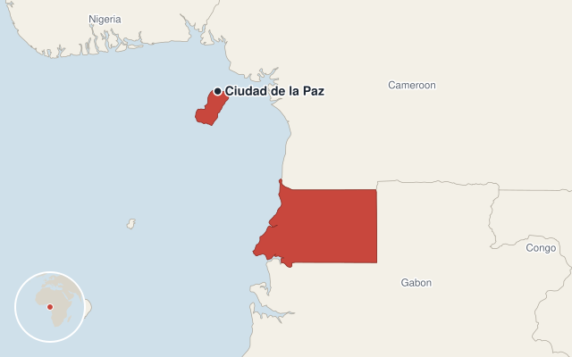

---
id    = "4b4a007d-0499-5828-96f9-869c5599afc8"
model = "Basic"
tags  = ["africa", "sovereign_state", "map"]
---

## Front

What is highlighted on this map?

## Back

<b>Equatorial Guinea</b>

## Extra

<a href="https://en.wikipedia.org/wiki/Equatorial_Guinea">Equatorial Guinea on Wikipedia</a>
