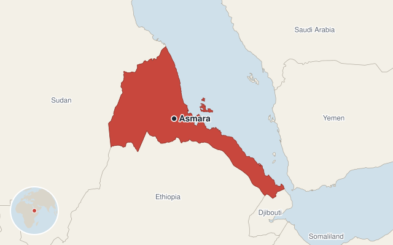

---
id    = "bbf755a6-a60b-5a4f-8f90-12c4b4ace913"
model = "Basic"
tags  = ["africa", "east_africa", "sovereign_state", "capital"]
---

## Front

What is the capital of <b>Eritrea</b>?

## Back

<b>Asmara</b>

## Extra

<a href="https://en.wikipedia.org/wiki/Asmara">Asmara on Wikipedia</a> <a href="https://en.wikipedia.org/wiki/Eritrea">Eritrea on Wikipedia</a>
