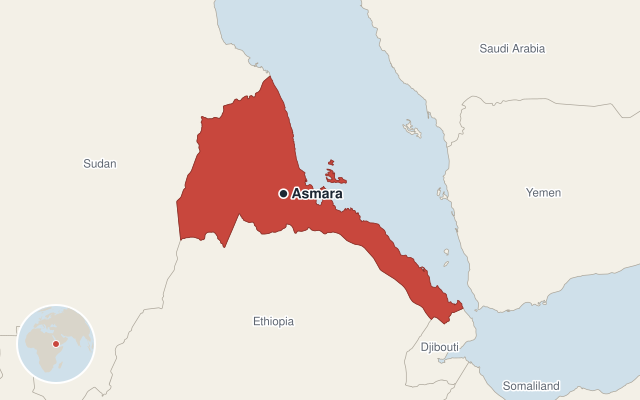

---
id    = "114e9550-6bcc-590d-ac2a-50484b9ae5ec"
model = "Basic"
tags  = ["africa", "east_africa", "sovereign_state", "country"]
---

## Front

<b>Asmara</b> is the capital of which country or territory?

## Back

<b>Eritrea</b>

## Extra

About 3.5 million people (2019) Extensive coastline on the Red Sea

The Kingdom of Aksum, centred in Eritrea and northern Ethiopia, was founded in the first or second century AD and adopted Christianity around the middle of the fourth century.

<a href="https://en.wikipedia.org/wiki/Eritrea">Eritrea on Wikipedia</a> <a href="https://en.wikipedia.org/wiki/Asmara">Asmara on Wikipedia</a>
