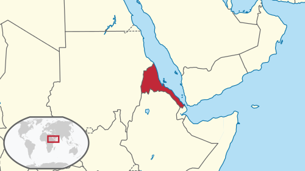

---
id    = "536c8afd-6952-5d0a-8e20-97ecc1e8fc48"
model = "Basic"
tags  = ["africa", "east_africa", "sovereign_state", "map"]
---

## Front

What is highlighted on this map?

## Back

<b>Eritrea</b>
