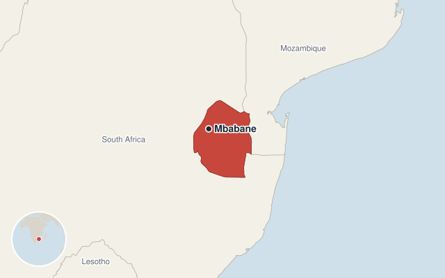

---
id    = "ee60ee1c-8a1c-5be4-9957-be8f0e665a85"
model = "Basic"
tags  = ["africa", "sovereign_state", "capital"]
---

## Front

What is the capital of <b>Eswatini</b>?

## Back

<b>Mbabane</b>

## Extra

While Mbabane is the official, executive capital, Lobamba is the traditional, spiritual and legislative capital.  Known as Swaziland until 2018.

<a href="https://en.wikipedia.org/wiki/Mbabane">Mbabane on Wikipedia</a> <a href="https://en.wikipedia.org/wiki/Eswatini">Eswatini on Wikipedia</a>
