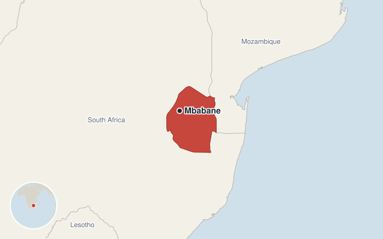

---
id    = "a192a791-1822-5692-8998-df3d513ad1d9"
model = "Basic"
tags  = ["africa", "sovereign_state", "country"]
---

## Front

<b>Mbabane</b> is the capital of which country or territory?

## Back

<b>Eswatini</b>

## Extra

About 1.23 million people (2023) Second-smallest country in continental Africa

Formerly Swaziland. In April 2018 the king changed the official name to Eswatini, the name commonly used in the Swazi language.

Known as Swaziland until 2018.  While Mbabane is the official, executive capital, Lobamba is the traditional, spiritual and legislative capital.

<a href="https://en.wikipedia.org/wiki/Eswatini">Eswatini on Wikipedia</a> <a href="https://en.wikipedia.org/wiki/Mbabane">Mbabane on Wikipedia</a>
