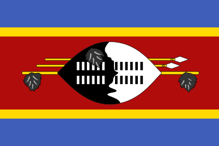
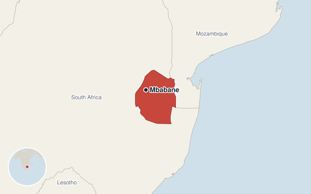

---
id    = "6ab6ae3c-00bc-507c-9ef8-21903a668075"
model = "Basic"
tags  = ["africa", "sovereign_state", "flag"]
---

## Front

Whose flag is this?

## Back

<b>Eswatini</b>

## Extra

Known as Swaziland until 2018.

<a href="https://en.wikipedia.org/wiki/Flag_of_Eswatini">Flag of Eswatini on Wikipedia</a> <a href="https://en.wikipedia.org/wiki/Eswatini">Eswatini on Wikipedia</a>
