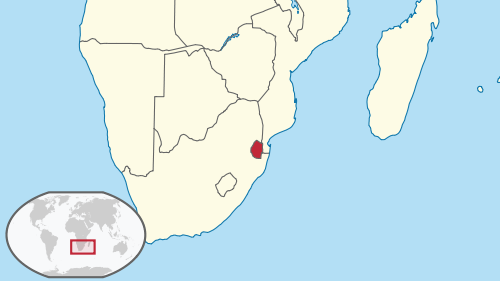
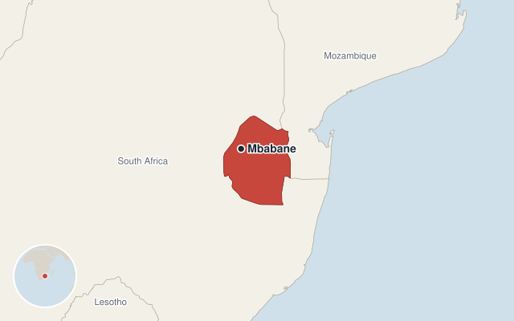

---
id    = "d9d3dad6-7c35-5a61-9e85-194236266596"
model = "Basic"
tags  = ["africa", "sovereign_state", "map"]
---

## Front

What is highlighted on this map?

## Back

<b>Eswatini</b>

## Extra

Borders South Africa and Mozambique No more than 200 km north to south and 130 km east to west

Small but varied: a cool, mountainous highveld gives way to a hot, dry lowveld.

Known as Swaziland until 2018.

<a href="https://en.wikipedia.org/wiki/Eswatini">Eswatini on Wikipedia</a>
