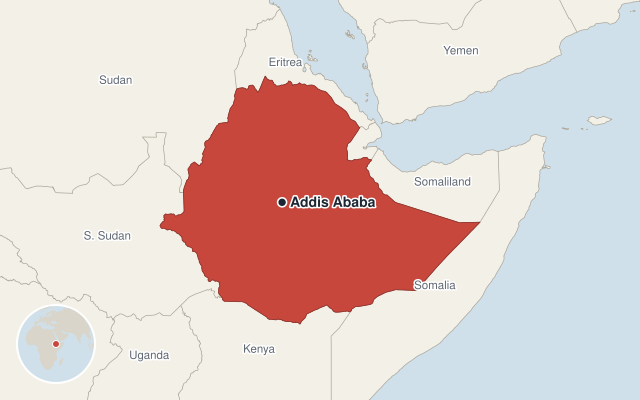

---
id    = "5ada2614-522e-5f61-a20b-66511d4bbf3c"
model = "Basic"
tags  = ["africa", "east_africa", "sovereign_state", "capital"]
---

## Front

What is the capital of <b>Ethiopia</b>?

## Back

<b>Addis Ababa</b>

## Extra

<a href="https://en.wikipedia.org/wiki/Addis_Ababa">Addis Ababa on Wikipedia</a> <a href="https://en.wikipedia.org/wiki/Ethiopia">Ethiopia on Wikipedia</a>
