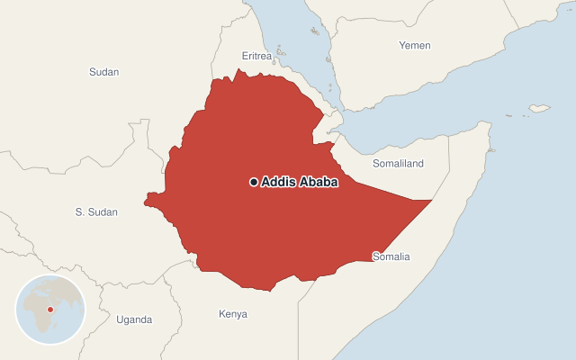

---
id    = "542721db-43a3-5cbe-9a2e-9930e1cc0998"
model = "Basic"
tags  = ["africa", "east_africa", "sovereign_state", "country"]
---

## Front

<b>Addis Ababa</b> is the capital of which country or territory?

## Back

<b>Ethiopia</b>

## Extra

<a href="https://en.wikipedia.org/wiki/Ethiopia">Ethiopia on Wikipedia</a> <a href="https://en.wikipedia.org/wiki/Addis_Ababa">Addis Ababa on Wikipedia</a>
