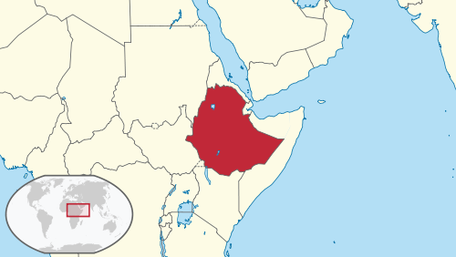
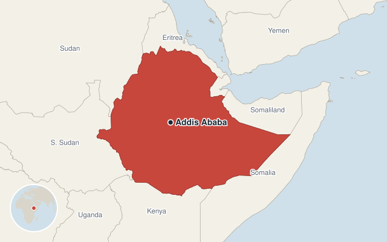

---
id    = "fcce5ee6-b2ed-52ee-9b43-5f4503786d06"
model = "Basic"
tags  = ["africa", "east_africa", "sovereign_state", "map"]
---

## Front

What is highlighted on this map?

## Back

<b>Ethiopia</b>

## Extra

Landlocked, bordering Eritrea, Djibouti, Somalia, Kenya, South Sudan and Sudan Highest point: Ras Dashen

The East African Rift splits the country into the African and Somali tectonic plates, with Addis Ababa a few kilometres west of it.

<a href="https://en.wikipedia.org/wiki/Ethiopia">Ethiopia on Wikipedia</a>
