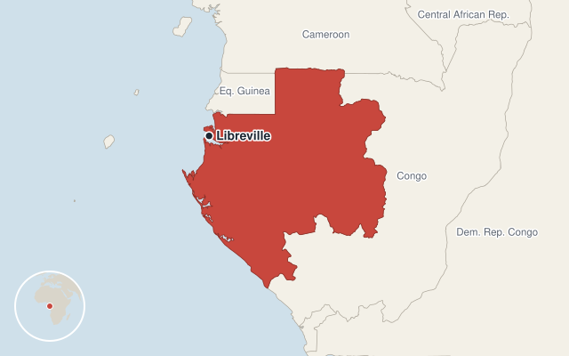

---
id    = "a496c1b6-e74b-545a-8354-5f8c52c71c59"
model = "Basic"
tags  = ["africa", "sovereign_state", "capital"]
---

## Front

What is the capital of <b>Gabon</b>?

## Back

<b>Libreville</b>

## Extra

<a href="https://en.wikipedia.org/wiki/Libreville">Libreville on Wikipedia</a> <a href="https://en.wikipedia.org/wiki/Gabon">Gabon on Wikipedia</a>
