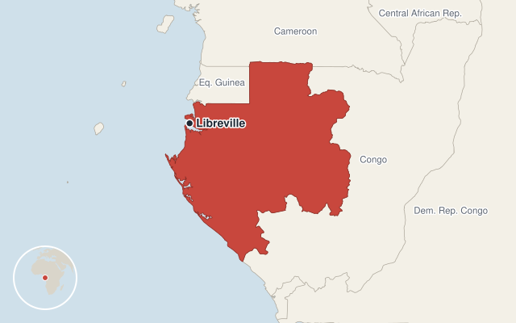

---
id    = "11a667d7-2533-5b68-97e1-a00340f89f89"
model = "Basic"
tags  = ["africa", "sovereign_state", "country"]
---

## Front

<b>Libreville</b> is the capital of which country or territory?

## Back

<b>Gabon</b>

## Extra

About 2.3 million people (2023) On the Atlantic coast, lying on the equator

Independent from France since 1960. The area's original inhabitants were the Bambenga, and Bantu migrants began settling there in the 13th century BCE.

<a href="https://en.wikipedia.org/wiki/Gabon">Gabon on Wikipedia</a> <a href="https://en.wikipedia.org/wiki/Libreville">Libreville on Wikipedia</a>
