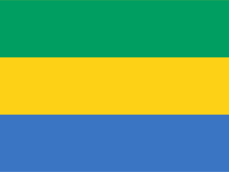
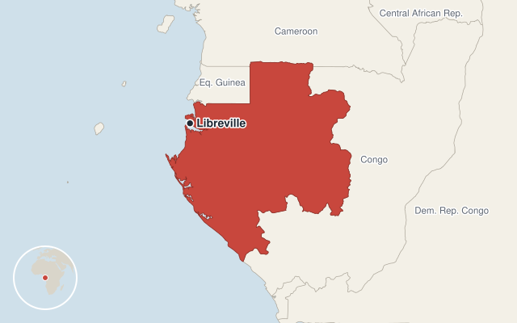

---
id    = "429d351a-e018-5928-8eab-325ad4f5c041"
model = "Basic"
tags  = ["africa", "sovereign_state", "flag"]
---

## Front

Whose flag is this?

## Back

<b>Gabon</b>

## Extra

Adopted in 1960, at independence

Yellow alludes to the Equator, which cuts across the country, and to the sun. Blue represents the South Atlantic coast. The French tricolour that once sat in the canton was removed.

<a href="https://en.wikipedia.org/wiki/Flag_of_Gabon">Flag of Gabon on Wikipedia</a> <a href="https://en.wikipedia.org/wiki/Gabon">Gabon on Wikipedia</a>
