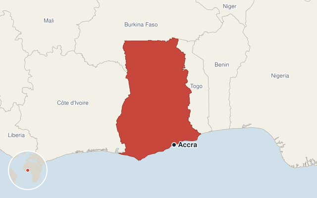
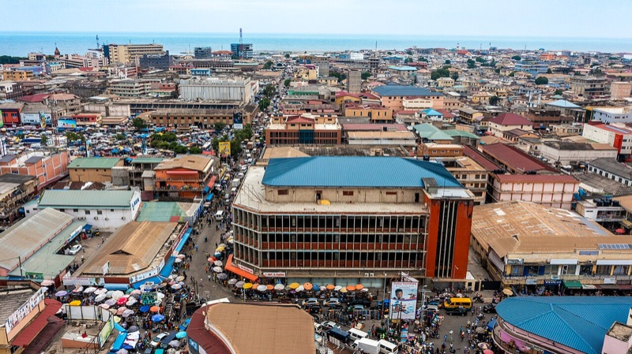

---
id    = "e25ea26b-5f72-5349-8275-626c825736e1"
model = "Basic"
tags  = ["africa", "sovereign_state", "west_africa", "capital"]
---

## Front

What is the capital of <b>Ghana</b>?

## Back

<b>Accra</b>

## Extra

<i>Photo: Goldenwabbit, CC BY-SA 4.0, via Wikimedia Commons</i>

About 1.78 million people in the capital's districts (2021 census) On the Gulf of Guinea

The name comes from the Akan word Nkran, "ants", for the anthills in the surrounding countryside. In 1877 it replaced Cape Coast as capital of the British Gold Coast.

<a href="https://en.wikipedia.org/wiki/Accra">Accra on Wikipedia</a> <a href="https://en.wikipedia.org/wiki/Ghana">Ghana on Wikipedia</a>
