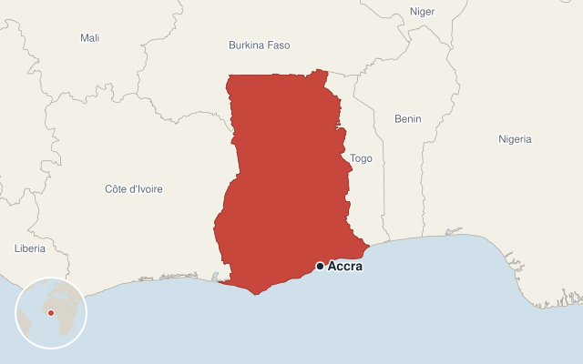
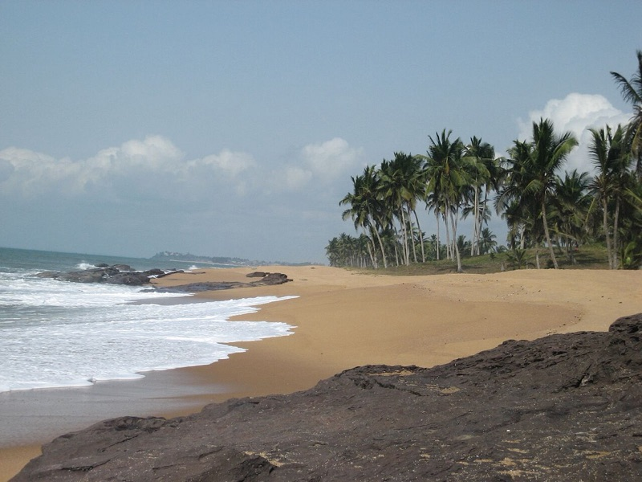

---
id    = "57830932-7239-56b5-a949-1fc12a344697"
model = "Basic"
tags  = ["africa", "sovereign_state", "west_africa", "country"]
---

## Front

<b>Accra</b> is the capital of which country or territory?

## Back

<b>Ghana</b>

## Extra

<i>Photo: Erik Kristensen, CC BY 2.0, via Wikimedia Commons</i>

About 32.8 million people (2021) Second most populous country in West Africa

On 6 March 1957 it became the first colony in Sub-Saharan Africa to achieve sovereignty, under the name Ghana.

<a href="https://en.wikipedia.org/wiki/Ghana">Ghana on Wikipedia</a> <a href="https://en.wikipedia.org/wiki/Accra">Accra on Wikipedia</a>
