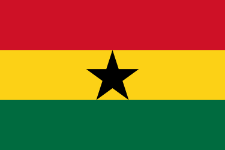

---
id    = "7af80a99-e72c-5a2c-b0be-6c6a865493fb"
model = "Basic"
tags  = ["africa", "sovereign_state", "west_africa", "flag"]
---

## Front

Whose flag is this?

## Back

<b>Ghana</b>

## Extra

Similar flags: Bolivia (coat of arms instead of star)
