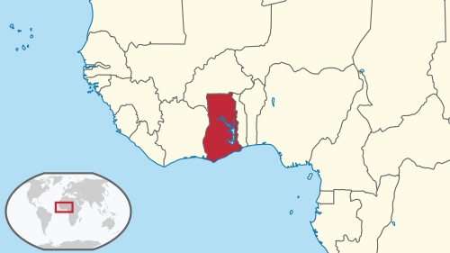
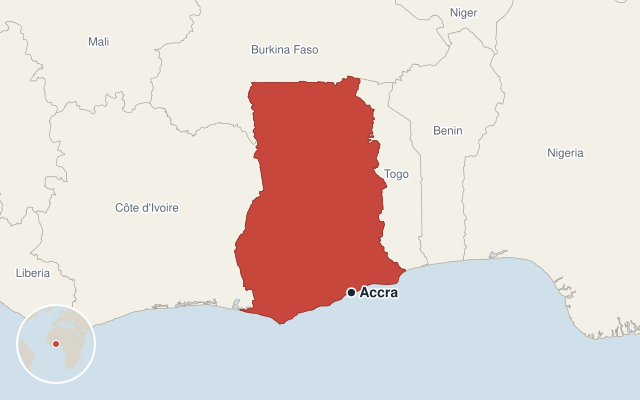
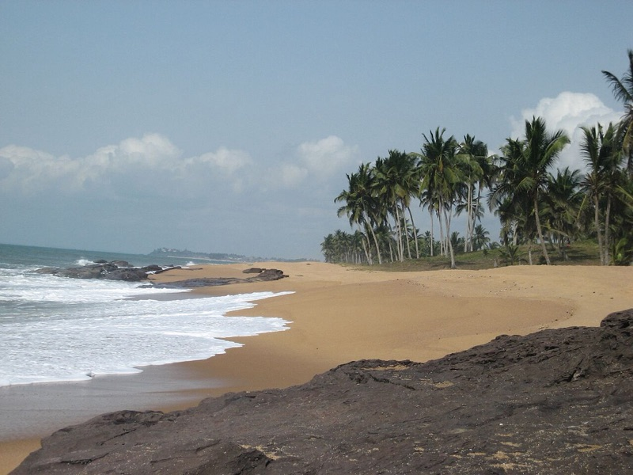

---
id    = "3881280d-50ac-543e-8e81-2e5aaf73f884"
model = "Basic"
tags  = ["africa", "sovereign_state", "west_africa", "map"]
---

## Front

What is highlighted on this map?

## Back

<b>Ghana</b>

## Extra

<i>Photo: Erik Kristensen, CC BY 2.0, via Wikimedia Commons</i>

Borders Ivory Coast, Burkina Faso and Togo Gulf of Guinea coast to the south

Spans many ecologies, from coastal savannas to tropical rainforests. Its highest point is Mount Afadja.

<a href="https://en.wikipedia.org/wiki/Ghana">Ghana on Wikipedia</a>
