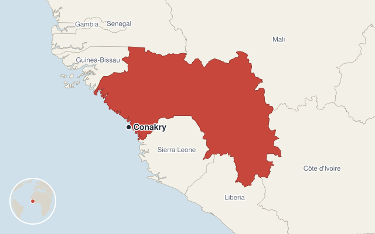
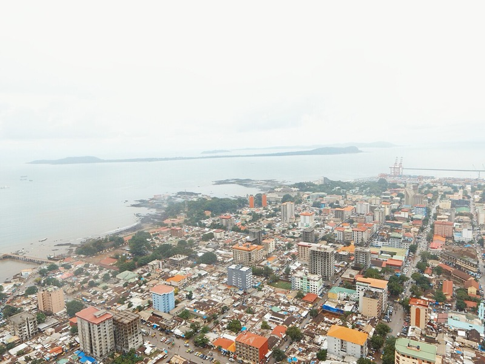

---
id    = "8b5d55e6-2439-5dc4-9658-75be3651e22e"
model = "Basic"
tags  = ["africa", "sovereign_state", "west_africa", "capital"]
---

## Front

What is the capital of <b>Guinea</b>?

## Back

<b>Conakry</b>

## Extra

<i>Photo: Alpha hmd, CC BY-SA 4.0, via Wikimedia Commons</i>

About 3.4 million people (2025 census) On the Kaloum Peninsula, a narrow strip of land

The city was essentially founded after Britain ceded Tombo Island to France in 1887. It became capital of French Guinea in 1904 and prospered as an export port.

<a href="https://en.wikipedia.org/wiki/Conakry">Conakry on Wikipedia</a> <a href="https://en.wikipedia.org/wiki/Guinea">Guinea on Wikipedia</a>
