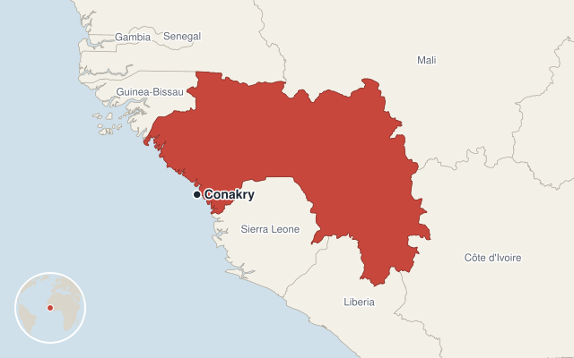

---
id    = "13cbcd5b-b291-540e-b58c-ea9d6f561f57"
model = "Basic"
tags  = ["africa", "sovereign_state", "west_africa", "country"]
---

## Front

<b>Conakry</b> is the capital of which country or territory?

## Back

<b>Guinea</b>

## Extra

<a href="https://en.wikipedia.org/wiki/Guinea">Guinea on Wikipedia</a> <a href="https://en.wikipedia.org/wiki/Conakry">Conakry on Wikipedia</a>
