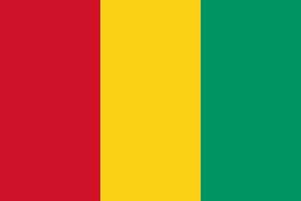

---
id    = "037106d9-a995-5a57-836e-5aac307973b1"
model = "Basic"
tags  = ["africa", "sovereign_state", "west_africa", "flag"]
---

## Front

Whose flag is this?

## Back

<b>Guinea</b>

## Extra

Similar flags: Mali (red and green flipped, slightly brighter green)
