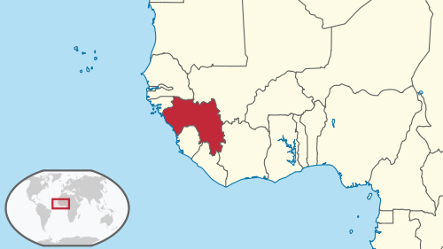
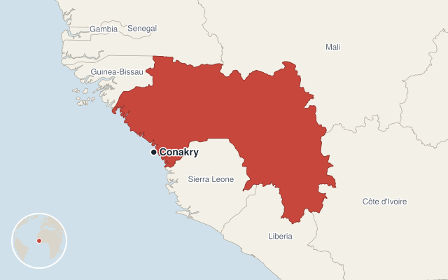

---
id    = "7e01527b-19fa-5bd0-a4c1-c80dbebcaca9"
model = "Basic"
tags  = ["africa", "sovereign_state", "west_africa", "map"]
---

## Front

What is highlighted on this map?

## Back

<b>Guinea</b>

## Extra

Atlantic coast, bordering Guinea-Bissau, Senegal, Mali, Ivory Coast, Sierra Leone and Liberia Highest point: Mount Richard-Molard

<a href="https://en.wikipedia.org/wiki/Guinea">Guinea on Wikipedia</a>
