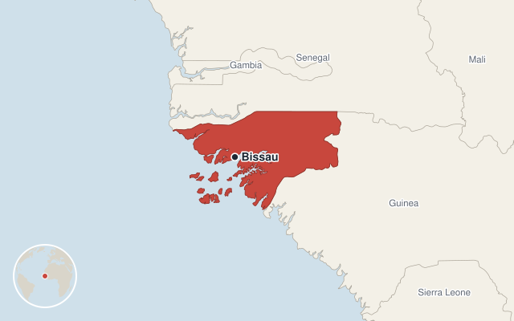

---
id    = "40eb8b94-3415-578b-afee-93dd17d8684c"
model = "Basic"
tags  = ["africa", "sovereign_state", "west_africa", "capital"]
---

## Front

What is the capital of <b>Guinea-Bissau</b>?

## Back

<b>Bissau</b>

## Extra

<a href="https://en.wikipedia.org/wiki/Bissau">Bissau on Wikipedia</a> <a href="https://en.wikipedia.org/wiki/Guinea-Bissau">Guinea-Bissau on Wikipedia</a>
