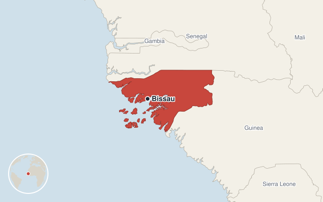

---
id    = "c5ffe518-16ad-5398-9904-d53b6bf37df4"
model = "Basic"
tags  = ["africa", "sovereign_state", "west_africa", "country"]
---

## Front

<b>Bissau</b> is the capital of which country or territory?

## Back

<b>Guinea-Bissau</b>

## Extra

About 1.86 million people (2017) About 36,125 km²

Its capital's name was added to the country's name after independence to prevent confusion with Guinea, formerly French Guinea.

<a href="https://en.wikipedia.org/wiki/Guinea-Bissau">Guinea-Bissau on Wikipedia</a> <a href="https://en.wikipedia.org/wiki/Bissau">Bissau on Wikipedia</a>
