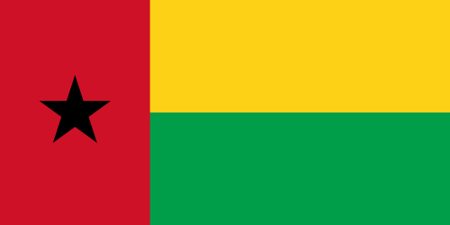
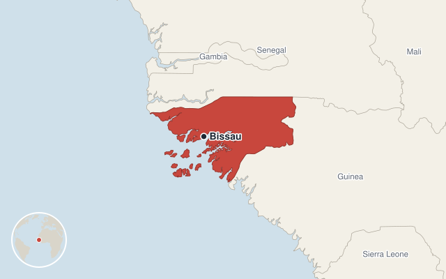

---
id    = "93a3e2d8-5733-57fe-a906-ed8896d4e7e4"
model = "Basic"
tags  = ["africa", "sovereign_state", "west_africa", "flag"]
---

## Front

Whose flag is this?

## Back

<b>Guinea-Bissau</b>

## Extra

Adopted on 24 September 1973, at independence

Almost identical to the flag of the PAIGC independence party. The black star stands for its leadership, yellow for the northern savannas and green for the southern forests.

<a href="https://en.wikipedia.org/wiki/Flag_of_Guinea-Bissau">Flag of Guinea-Bissau on Wikipedia</a> <a href="https://en.wikipedia.org/wiki/Guinea-Bissau">Guinea-Bissau on Wikipedia</a>
