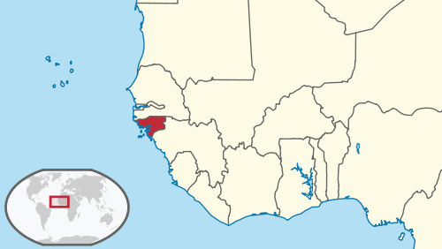

---
id    = "3bd97892-178f-5b23-a181-d9ea26e9619a"
model = "Basic"
tags  = ["africa", "sovereign_state", "west_africa", "map"]
---

## Front

What is highlighted on this map?

## Back

<b>Guinea-Bissau</b>
