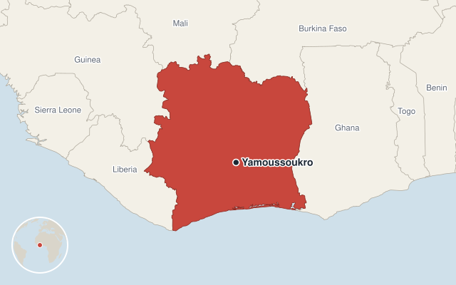

---
id    = "f6ceb81e-43cf-572a-924c-b45c5c618405"
model = "Basic"
tags  = ["africa", "sovereign_state", "west_africa", "capital"]
---

## Front

What is the capital of <b>Ivory Coast</b>?

## Back

<b>Yamoussoukro</b>

## Extra

While Yamoussoukro is the official capital, Abidjan is the de facto seat of government.  Officially Côte d'Ivoire.

<a href="https://en.wikipedia.org/wiki/Yamoussoukro">Yamoussoukro on Wikipedia</a> <a href="https://en.wikipedia.org/wiki/Ivory_Coast">Ivory Coast on Wikipedia</a>
