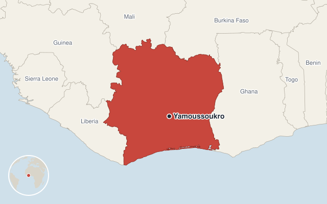

---
id    = "6efc4a47-9d24-519d-961f-f57ada066158"
model = "Basic"
tags  = ["africa", "sovereign_state", "west_africa", "country"]
---

## Front

<b>Yamoussoukro</b> is the capital of which country or territory?

## Back

<b>Ivory Coast</b>

## Extra

About 33.2 million people (2026) Third most populous country in West Africa

Around 78 languages are spoken. French is official, and Bété, Baoulé and Dyula are among the widely used indigenous ones.

Officially Côte d'Ivoire.  While Yamoussoukro is the official capital, Abidjan is the de facto seat of government.

<a href="https://en.wikipedia.org/wiki/Ivory_Coast">Ivory Coast on Wikipedia</a> <a href="https://en.wikipedia.org/wiki/Yamoussoukro">Yamoussoukro on Wikipedia</a>
