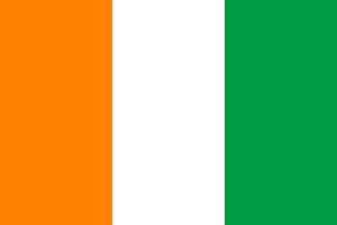

---
id    = "8fcbdc7f-c3c5-5a70-9bd2-ed32c2e0fa2e"
model = "Basic"
tags  = ["africa", "sovereign_state", "west_africa", "flag"]
---

## Front

Whose flag is this?

## Back

<b>Ivory Coast</b>

## Extra

Similar flags: Ireland (orange and green flipped, wider)  Officially Côte d'Ivoire.
