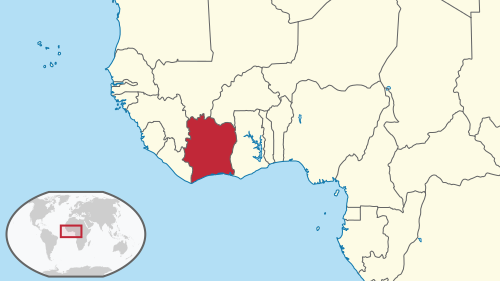

---
id    = "0704add7-9113-5abf-8978-d776a7e195e6"
model = "Basic"
tags  = ["africa", "sovereign_state", "west_africa", "map"]
---

## Front

What is highlighted on this map?

## Back

<b>Ivory Coast</b>

## Extra

Officially Côte d'Ivoire.
