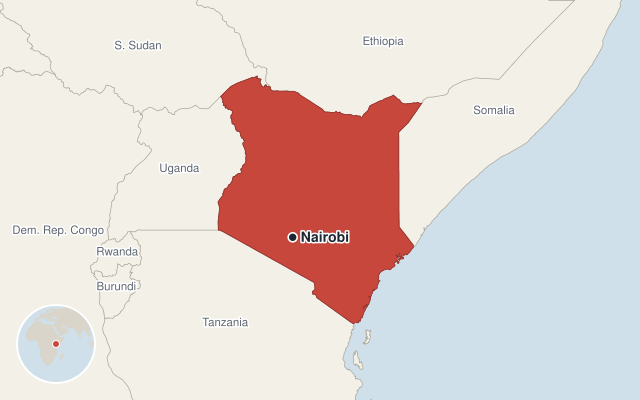

---
id    = "bda5be6d-2407-525f-802b-8f71cce9e68f"
model = "Basic"
tags  = ["africa", "east_africa", "sovereign_state", "capital"]
---

## Front

What is the capital of <b>Kenya</b>?

## Back

<b>Nairobi</b>

## Extra

About 5.6 million people (2026) 1,661 m up

Its name comes from the Maasai Enkare Nyirobi, "place of cool waters". It is the only capital in the world with a national park inside its boundaries.

<a href="https://en.wikipedia.org/wiki/Nairobi">Nairobi on Wikipedia</a> <a href="https://en.wikipedia.org/wiki/Kenya">Kenya on Wikipedia</a>
