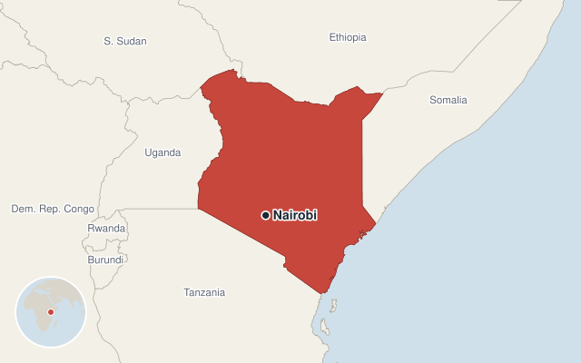

---
id    = "623bed88-0179-5d00-8e8e-6ffd5401d04b"
model = "Basic"
tags  = ["africa", "east_africa", "sovereign_state", "country"]
---

## Front

<b>Nairobi</b> is the capital of which country or territory?

## Back

<b>Kenya</b>

## Extra

About 54 million people (2026) Seventh most populous country in Africa

Its earliest inhabitants included some of the first humans to evolve from ancestral members of the genus Homo.

<a href="https://en.wikipedia.org/wiki/Kenya">Kenya on Wikipedia</a> <a href="https://en.wikipedia.org/wiki/Nairobi">Nairobi on Wikipedia</a>
