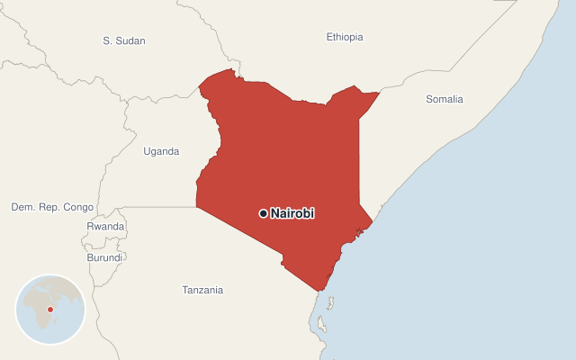

---
id    = "ffd07975-fe6f-5935-9b91-1bb3b0fedd4b"
model = "Basic"
tags  = ["africa", "east_africa", "sovereign_state", "map"]
---

## Front

What is highlighted on this map?

## Back

<b>Kenya</b>

## Extra

Borders South Sudan, Ethiopia, Somalia, Tanzania and Uganda Indian Ocean coast to the southeast

The terrain runs from snow-capped peaks on Mount Kenya to absolute deserts such as the Chalbi and Nyiri. Lake Victoria lies on the western edge.

<a href="https://en.wikipedia.org/wiki/Kenya">Kenya on Wikipedia</a>
