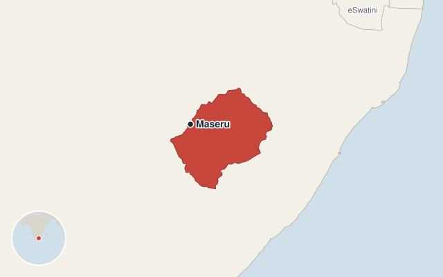
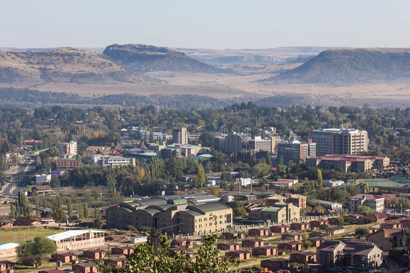

---
id    = "7933f8e6-355c-5b8f-a08a-0e36369bceac"
model = "Basic"
tags  = ["africa", "sovereign_state", "capital"]
---

## Front

What is the capital of <b>Lesotho</b>?

## Back

<b>Maseru</b>

## Extra

<i>Photo: OER Africa, OER Africa, via Wikimedia Commons</i>

About 331,000 people (2016 census) On the Caledon River, directly on the South African border

The name is a Sesotho word meaning "red sandstones". The British founded it as a police camp in 1869, and it kept its status as capital at independence in 1966.

<a href="https://en.wikipedia.org/wiki/Maseru">Maseru on Wikipedia</a> <a href="https://en.wikipedia.org/wiki/Lesotho">Lesotho on Wikipedia</a>
