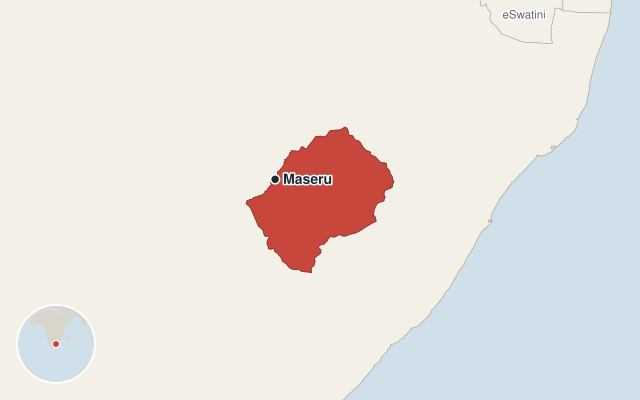

---
id    = "f59e94e0-33a0-5d85-a59a-1ab5d75debb2"
model = "Basic"
tags  = ["africa", "sovereign_state", "country"]
---

## Front

<b>Maseru</b> is the capital of which country or territory?

## Back

<b>Lesotho</b>

## Extra

About 2.2 million people (2017) Entirely surrounded by South Africa

The largest of the three sovereign, non-exclave enclaves in the world. The Sotho people, who give the country its name, make up 99.7% of the population.

<a href="https://en.wikipedia.org/wiki/Lesotho">Lesotho on Wikipedia</a> <a href="https://en.wikipedia.org/wiki/Maseru">Maseru on Wikipedia</a>
