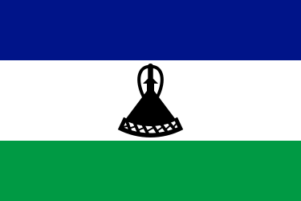
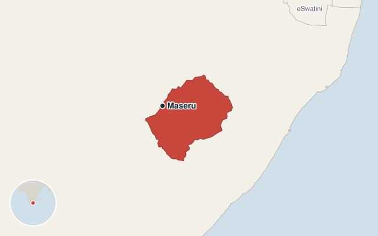

---
id    = "a42dff8c-a3a2-5c7e-bad6-8a26c97209ef"
model = "Basic"
tags  = ["africa", "sovereign_state", "flag"]
---

## Front

Whose flag is this?

## Back

<b>Lesotho</b>

## Extra

Adopted on 4 October 2006, 40 years after independence

The black mokorotlo, a Basotho hat, replaced a military emblem of shield and spear. The design is meant to show peace within the country and with South Africa.

<a href="https://en.wikipedia.org/wiki/Flag_of_Lesotho">Flag of Lesotho on Wikipedia</a> <a href="https://en.wikipedia.org/wiki/Lesotho">Lesotho on Wikipedia</a>
