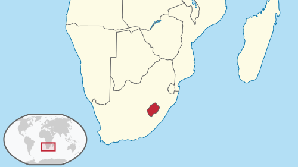
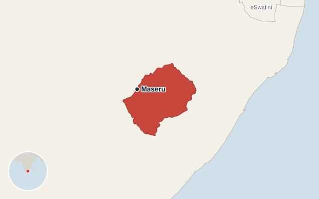

---
id    = "19fdb978-f841-5d08-9042-14283f3af0dd"
model = "Basic"
tags  = ["africa", "sovereign_state", "map"]
---

## Front

What is highlighted on this map?

## Back

<b>Lesotho</b>

## Extra

About 30,355 km² Highest point: Thabana Ntlenyana

Lies in the Maloti Mountains, which hold the highest peak in southern Africa. South Africa surrounds it on every side.

<a href="https://en.wikipedia.org/wiki/Lesotho">Lesotho on Wikipedia</a>
