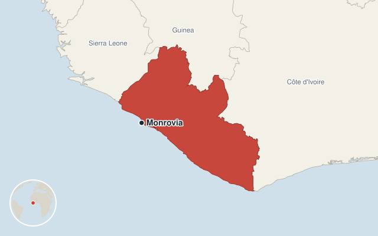
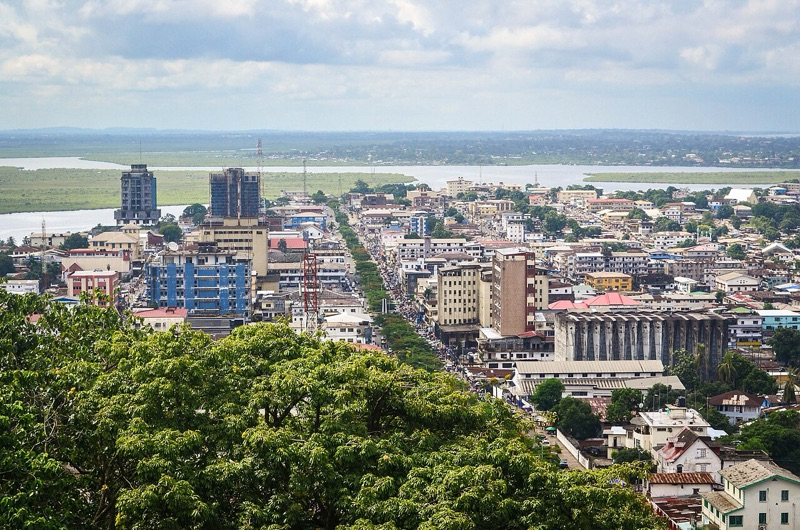

---
id    = "4d51cbf0-2b5d-519a-b063-d795eb8c9944"
model = "Basic"
tags  = ["africa", "sovereign_state", "west_africa", "capital"]
---

## Front

What is the capital of <b>Liberia</b>?

## Back

<b>Monrovia</b>

## Extra

<i>Photo: blk24ga, blk24ga, via Wikimedia Commons</i>

About 1.76 million people (2022 census) On Cape Mesurado, on the Atlantic coast

Founded in April 1822 by the American Colonization Society as a settlement for free people of color, and named for US President James Monroe, a supporter of the project.

<a href="https://en.wikipedia.org/wiki/Monrovia">Monrovia on Wikipedia</a> <a href="https://en.wikipedia.org/wiki/Liberia">Liberia on Wikipedia</a>
