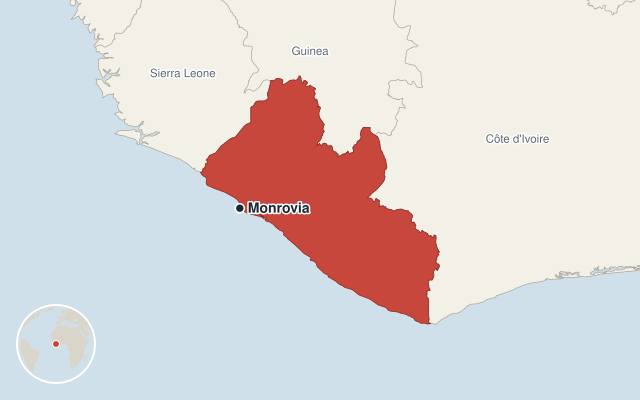

---
id    = "8e90da70-b1d6-542c-b1be-0feaa7372dab"
model = "Basic"
tags  = ["africa", "sovereign_state", "west_africa", "country"]
---

## Front

<b>Monrovia</b> is the capital of which country or territory?

## Back

<b>Liberia</b>

## Extra

About 5.2 million people (2021) English is official, with over 20 indigenous languages

It began as an American Colonization Society project to settle freed Black Americans in Africa. Liberia declared independence on 26 July 1847.

<a href="https://en.wikipedia.org/wiki/Liberia">Liberia on Wikipedia</a> <a href="https://en.wikipedia.org/wiki/Monrovia">Monrovia on Wikipedia</a>
