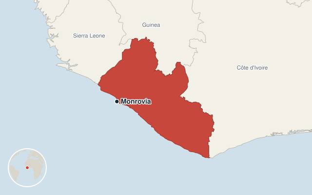

---
id    = "e5f7320d-b21e-5115-83d9-a7b095872bd2"
model = "Basic"
tags  = ["africa", "sovereign_state", "west_africa", "flag"]
---

## Front

Whose flag is this?

## Back

<b>Liberia</b>

## Extra

Adopted on 24 August 1847

Its stripes and star echo the US flag, for the country's founding by free people of color and former slaves from the United States. A committee of seven women hand-stitched it.

<a href="https://en.wikipedia.org/wiki/Flag_of_Liberia">Flag of Liberia on Wikipedia</a> <a href="https://en.wikipedia.org/wiki/Liberia">Liberia on Wikipedia</a>
