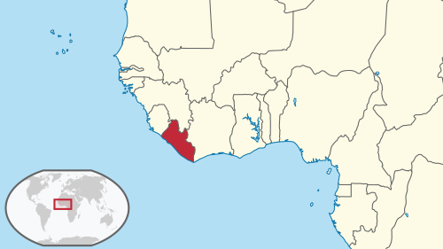

---
id    = "f44a59f6-f2cb-5a86-b3d8-29715fa1e08f"
model = "Basic"
tags  = ["africa", "sovereign_state", "west_africa", "map"]
---

## Front

What is highlighted on this map?

## Back

<b>Liberia</b>
