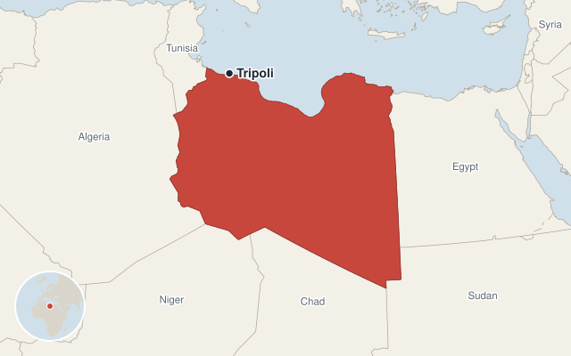

---
id    = "f1889e70-b526-5a04-8f46-ce5ad2ab45d3"
model = "Basic"
tags  = ["africa", "mediterranean", "sovereign_state", "capital"]
---

## Front

What is the capital of <b>Libya</b>?

## Back

<b>Tripoli</b>

## Extra

<a href="https://en.wikipedia.org/wiki/Tripoli,_Libya">Tripoli, Libya on Wikipedia</a> <a href="https://en.wikipedia.org/wiki/Libya">Libya on Wikipedia</a>
