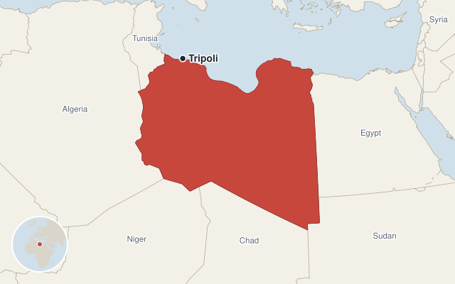

---
id    = "e42a6a90-94e1-5520-a57a-1e33666920c1"
model = "Basic"
tags  = ["africa", "mediterranean", "sovereign_state", "country"]
---

## Front

<b>Tripoli</b> is the capital of which country or territory?

## Back

<b>Libya</b>

## Extra

<a href="https://en.wikipedia.org/wiki/Libya">Libya on Wikipedia</a> <a href="https://en.wikipedia.org/wiki/Tripoli,_Libya">Tripoli, Libya on Wikipedia</a>
