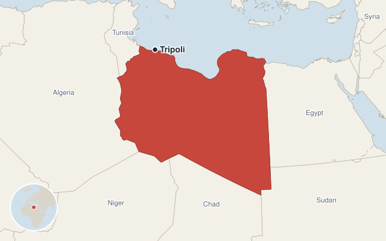

---
id    = "24ba7c40-619e-52ac-9790-9eeac2af9a20"
model = "Basic"
tags  = ["africa", "mediterranean", "sovereign_state", "flag"]
---

## Front

Whose flag is this?

## Back

<b>Libya</b>

## Extra

<a href="https://en.wikipedia.org/wiki/Flag_of_Libya">Flag of Libya on Wikipedia</a> <a href="https://en.wikipedia.org/wiki/Libya">Libya on Wikipedia</a>
