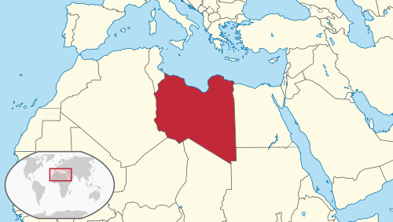
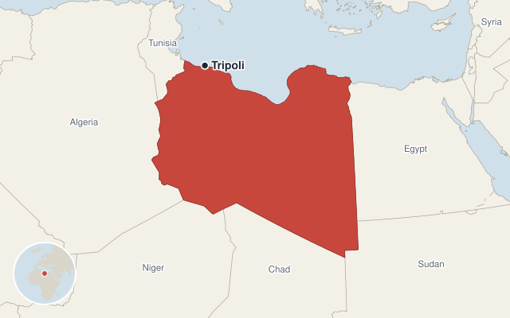

---
id    = "884521c3-5624-53ea-9e08-0bc3b1e7b7ac"
model = "Basic"
tags  = ["africa", "mediterranean", "sovereign_state", "map"]
---

## Front

What is highlighted on this map?

## Back

<b>Libya</b>

## Extra

Borders Egypt, Sudan, Chad, Niger, Algeria and Tunisia Almost 1.8 million km²

<a href="https://en.wikipedia.org/wiki/Libya">Libya on Wikipedia</a>
