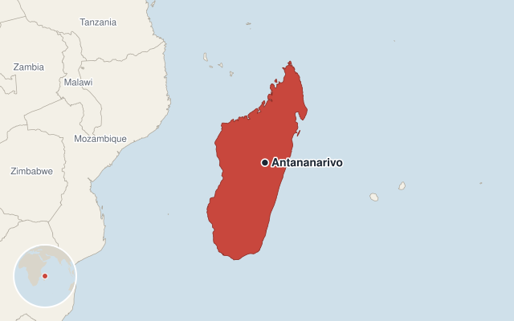
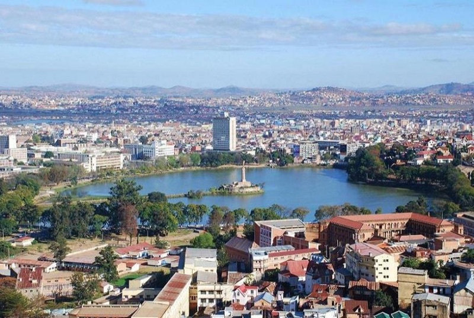

---
id    = "5a4a596f-1c71-5c0a-8eb2-a0644a6b13a0"
model = "Basic"
tags  = ["africa", "east_africa", "sovereign_state", "capital"]
---

## Front

What is the capital of <b>Madagascar</b>?

## Back

<b>Antananarivo</b>

## Extra

<i>Photo: Sascha Grabow www.saschagrabow.com, CC BY-SA 3.0, via Wikimedia Commons</i>

About 1.28 million people (2018) 1,276 m up, in the centre of the island

The highest national capital among island countries. Historically the capital of the Merina people, it has been the country's largest population centre since at least the 18th century.

<a href="https://en.wikipedia.org/wiki/Antananarivo">Antananarivo on Wikipedia</a> <a href="https://en.wikipedia.org/wiki/Madagascar">Madagascar on Wikipedia</a>
